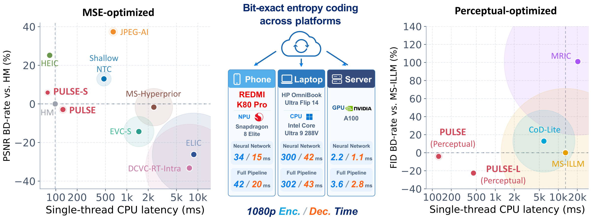
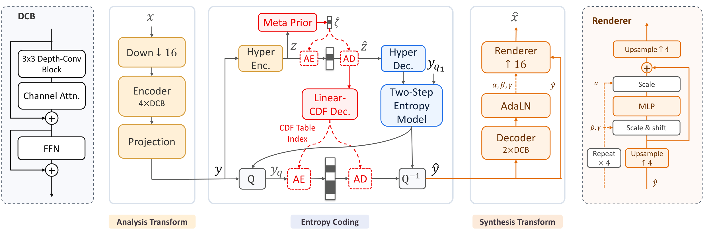

# Which Bits Can Be Dropped?

Component-wise quantization, mixed-precision selection and quantization-aware fine-tuning for the
PULSE learned image codec. CS6886 final project.

Report (2 pages): `submission/report.pdf` | Slides: `submission/PULSE-quantization-deck.pdf` |
Runbook: `RUNBOOK.md`

---

## 1. What PULSE is, and what was added after the clone

PULSE is a learned image codec. A convolutional encoder maps an image to a latent. A learned entropy
model codes that latent with a range coder. A convolutional decoder rebuilds the image. PULSE is known
for fast single-thread CPU decoding and for bit-exact entropy coding across platforms.

This repository is a fork of `microsoft/GenCodec`, which holds the PULSE release. The upstream part is
`codec/`, `deployment/`, `configs/` and the training scripts. It is unchanged. One study was added on
top of the released `pulse-mse` checkpoint, in `quantization-pluse-mse/`.

PULSE ships one weight file of 54.688 MB. That file serves eight quality settings. A precision cannot
be chosen for each setting, because one file must satisfy all eight.

## 2. The challenge, and how it was approached

**The challenge.** The usual way to shrink a model is one precision for the complete model, because a
study of each part takes time. That method is a loss here. The parts are not equal:

| Group | Parameters | Share | Behaviour |
|---|---|---|---|
| Encoder E0-E5 | 12.13M | 85.6% | large, and cheap to quantize |
| Entropy H0-H3 | 1.34M | 9.4% | small, and takes 73% of a decode |
| Decoder D0-D8 | 708k | 5.0% | small, but one 4.7k block loses 8% at 8 bits |

A 2.89M encoder block loses 0.5% at 8 bits. A 4.7k renderer block loses 8% at the same precision.
Sensitivity does not follow size.

**The journey, in four steps.**

1. *Measure.* One part was quantized at a time, all other parts stayed in FP32, and the complete codec
   ran on every image at every setting. That is 7 formats x 19 parts x 8 settings x 2 datasets: 69,233
   rows. Two safeguards were added. An FP32 gate must reproduce the reference bitstream. A hash check
   must confirm each weight restoration.
2. *Check the assumptions.* The solver adds single-part costs, so additivity was tested. They
   do: the ratio is 0.96 to 1.05 on Kodak and 1.02 to 1.11 on CLIC.
3. *Allocate.* The choice is stated as a mixed-integer linear program. One binary variable for each
   pair of a part and a format, shared across all eight settings, with one quality limit for each
   setting. The objective is bytes. Latency was not used, because no measured latency table
   exists for each format, and an objective with invented data is not a result.
4. *Repair.* The aggressive assignments were fine-tuned. Quantized convolutions ran with a
   straight-through gradient, and an augmented Lagrangian held the bitrate at its old value while it
   pushed distortion down. The entropy parts stayed frozen, because the bundle holds integer CDF
   tables and moving the entropy weights would break the contract between encoder and decoder.

**What was expected.** A large size reduction at a small quality cost, fine-tuning that recovers most
of the remaining cost, and a small latency win.

## 3. What was measured

Expected and measured, side by side. Values are worst-setting rate-equivalent penalty against FP32.

| | Expected | Measured |
|---|---|---|
| Size at the 1% budget | about 22 MB | **21.677 MB (-60.4%)** |
| Quality cost at that budget | under 1% | **0.94%** worst case, BD-rate +0.48 to +0.55% |
| Fine-tuning on aggressive tiers | large repair | **61% to 98% of the damage removed** |
| Fine-tuning on the optimal tier | small repair | **0.0%** |
| Latency | a small win | **no win.** 4.79% slower, interval +1.27 to +9.80 |

| Configuration | Size | Kodak | CLIC | Set14 |
|---|---|---|---|---|
| **ILP mixed, 1% budget** | **21.677 MB** | **0.672%** | **0.851%** | **0.935%** |
| ILP mixed, 1.8% budget | 18.664 MB | 1.268% | 1.595% | 1.601% |
| INT8 tier + fine-tuning | 14.401 MB | 1.848% | 2.874% | 3.363% |
| uniform INT8 | 13.904 MB | 26.184% | 56.701% | 19.374% |

The last two rows decide the argument. Uniform INT8 gives a smaller file than the champion, and it
loses 39 times more quality on Kodak and 67 times on CLIC. The problem is granularity, not
quantization.

**The models in this repository.**

| Model | Where it lives | Form |
|---|---|---|
| FP32 base (`pulse-mse`) | `checkpoints/pulse-mse/` (not tracked, 84 MB) | Download from HuggingFace |
| Champion, 21.677 MB | `quantization-pluse-mse/results/ilp/assignment_ilp_b1p0.json` | Precision map |
| Variant, 18.664 MB | `quantization-pluse-mse/results/ilp/assignment_ilp_b1p8.json` | Precision map |
| INT8 tier + fine-tuning, 14.401 MB | `quantization-pluse-mse/results/night/qat_int8_12k/bundles/` | Precision map plus weights |

Weight files are not stored in git, because each one is 56 MB. A precision map plus the base
checkpoint defines each operating point exactly. RUNBOOK section 7.4 rebuilds a fine-tuned bundle.

## 4. Conclusion, commands and layout

**Conclusion.** Granularity is the lever. At the same size, mixed precision is 39 times better than
uniform precision. Fine-tuning replaces a good allocation and does not extend it: it removed 61% to 98%
of the damage on hand-chosen assignments and 0% on the assignment the solver optimized. Quantization
did not make this codec faster. A decode spends 80 of its 88 ms in entropy coding, and only 8 ms in the
network that quantization accelerates.

**Run it.**

```bash
python -m venv venv && .\venv\Scripts\activate      # source venv/bin/activate on POSIX
pip install -r requirements.txt
pip install -e . --no-build-isolation                # builds the entropy extension
```

```powershell
# headline number: 21.677 MB and 0.672% on Kodak
.\venv\Scripts\python.exe quantization-pluse-mse\scripts\eval_assignment.py `
  --model checkpoints/pulse-mse `
  --configs quantization-pluse-mse\results\ilp\assignment_ilp.json `
  --dataset kodak --output results\check

# solve a different budget
.\venv\Scripts\python.exe quantization-pluse-mse\scripts\solve_ilp.py --budget 1.0 1.8 --headline 1.0

# tests
.\venv\Scripts\python.exe -m unittest discover -s quantization-pluse-mse\tests
```

**Layout.**

| Path | Contents |
|---|---|
| `codec/` | PULSE model, entropy coding and runtime. Upstream code. |
| `checkpoints/pulse-mse/` | The FP32 base model. Not tracked. |
| `quantization-pluse-mse/scripts/` | Entry points: sweep, analysis, ILP, evaluation, fine-tuning. |
| `quantization-pluse-mse/results/` | Every measured table, figure and precision map. |
| `quantization-pluse-mse/STATUS.md` | The project checkpoint: all numbers, all open items, all traps. |
| `quantization-pluse-mse/RESOURCES.md` | A map from each claim to the file that proves it, with citations. |
| `quantization-pluse-mse/results/qat/WHY_THESE_COMPONENTS.md` | Why these parts were chosen, with the cost per MB. |
| `submission/` | The 2-page report, the slides, and a 5-page supplement. |
| `datasets/` | Kodak, CLIC Professional, Set14 and the fine-tuning pool. Images not tracked. |
| `RUNBOOK.md` | Setup, every command, runtimes, troubleshooting. |
| `docker/` | One Linux container for the evaluation path and the tests. |
| `docs/archive/` | Earlier working notes, kept for provenance. |

## 5. Resources

| Need | Value |
|---|---|
| Python | 3.12 |
| PyTorch | 2.6.0 with CUDA 12.4 |
| GPU | 4 GB is enough. One RTX 3050 Laptop was used. |
| CPU-only | Works for evaluation. Fine-tuning wants the GPU. |
| Disk | About 10 GB free |
| Solver | HiGHS through `scipy.optimize.milp`. Already in the requirements. |
| Checkpoint | `pulse-mse` from https://huggingface.co/zhaoyangjia/PULSE |
| Documents | LaTeX through Tectonic, `python-docx`, `python-pptx` |

Datasets: Kodak (24 images, screening), CLIC Professional (41, confirmation), Set14 (14, transfer
check), DIV2K validation (100, fine-tuning pool only). No images are tracked.

Two files that upstream shipped are not in this repository, to keep it under 10 MB: the paper PDF and
proposal material, and the sample `image.png` that the upstream commands use as an example input.
Supply your own image if you run those examples.

To skip the native install, use the container: `docker/README.md` has the build and three run
commands. The container is written but was not built on the development machine.

The complete method and the result tables are in `submission/report.pdf`. The engineering record,
including the mistakes made and corrected, is in `quantization-pluse-mse/STATUS.md`.

---

## Upstream PULSE (original README)

<h2 align="center">PULSE: Unlocking Practical Image Compression on Single-Thread CPU</h2>

<p align="center">
  <a href="https://arxiv.org/abs/2609.18602"></a>
  <a href="https://github.com/microsoft/GenCodec/tree/main/PULSE"></a>
  <a href="https://huggingface.co/zhaoyangjia/PULSE"></a>
</p>

---

## 📖 Introduction

**PULSE** is an asymmetric, variable-rate neural image codec that combines
**ultra-low-complexity decoding**, **bit-exact entropy coding**, and
**MSE or perceptual optimization** for practical compression on
resource-constrained hardware.

[Paper](https://arxiv.org/abs/2609.18602) |
[Training](docs/training.md) |
[Deployment](docs/deployment.md)



## ✨ Highlight

PULSE pairs low-resolution feature processing with an **AdaLN-modulated pixel
renderer** and a **two-step entropy model**. A content-adaptive **Meta Prior**
compensates for the reduced capacity of the linear CDF decoder, especially in
low-content-complexity regions. It features:

- ⚡ **Single-thread CPU decoding** — The base receiver requires just
  **5.2 kMAC/pixel**. The paper reports **126 ms** decoding for a **1080p** image
  on one AMD EPYC 9V84 CPU thread.
- 🌐 **Cross-platform entropy coding** — **Integer Linear CDF prediction + CPU
  rANS** keep entropy coding bit-exact while neural transforms can run on
  accelerators; floating-point reconstructed pixels need not be bit-identical.
- 🎨 **Flexible rate and quality** — **Eight quality levels per model**, with
  MSE models for S/base and perceptual models for base/L, including
  face/text-aware fine-tuning.
- 🗜️ **Train, compress, and deploy.** This release includes training, Meta Prior
post-training, integer Linear CDF export, y CDF calibration, and independent `.pulse` compression
and decompression. Optimized AMD CPU and H100 benchmarks include entropy coding;
the mobile path provides whole-image QNN/ARM compression and decompression.

<p align="center">
  
</p>

## 🧩 Models

Each model supports eight QPs (`0`–`7`), from lower to higher rate/quality.

| Model | Receiver complexity | Weights | Training config |
|---|---:|---|---|
| PULSE-S (MSE) | ~2.7 kMAC/pixel | `pulse-s-mse` | [Config](configs/mse/s.yaml) |
| PULSE (MSE) | ~5.2 kMAC/pixel | `pulse-mse` | [Config](configs/mse/base.yaml) |
| PULSE (Perceptual) | ~5.2 kMAC/pixel | `pulse-perceptual` | [Config](configs/perceptual/base.yaml) |
| PULSE-L (Perceptual) | ~20 kMAC/pixel | `pulse-l-perceptual` | [Config](configs/perceptual/l.yaml) |

Pretrained bundles and training recipes are provided for these four models.

## 🛠️ Installation

Use Python 3.12 and a C++17 compiler for the pinned environment below.
Install PyTorch 2.5.0 / torchvision 0.20.0 wheels appropriate for your CPU/CUDA
environment, then install PULSE:

```bash
git clone https://github.com/microsoft/GenCodec.git
cd GenCodec/PULSE
pip install -r requirements.txt
pip install -e .
```

This builds the CPU rANS and integer-CDF extension; a CUDA compiler is not
required. Tested with Python 3.12, PyTorch 2.5.0 and torchvision 0.20.0 on Linux.
`requirements.txt` pins the direct dependencies for training, evaluation,
inference and model downloads. Optional ONNX/OpenVINO dependencies are in
`requirements-deploy.txt`. These files are not transitive lockfiles.
For a minimal inference-only installation on Python 3.10+, use
`pip install -e ".[download]"` instead.
ONNX export explicitly uses the TorchScript exporter rather than relying on
version-dependent defaults.

Non-editable installs also include recipes and `pulse-compress`,
`pulse-decompress`, `pulse-train-mse`, `pulse-train-perceptual` and the other
`pulse-*` command-line entry points.

## 📥 Download checkpoints

```bash
python download_models.py --models pulse-mse pulse-perceptual
```

Bundles contain `config.json`, `model.pt`, and `entropy_control_int.pt`.
Keep these files together. Downloads are checked against SHA256 hashes.
Use `--revision <commit>` to pin a Hugging Face model revision.

## 🗜️ Compress and decompress

```bash
python compress.py --model checkpoints/pulse-mse \
  --input image.png --output outputs/image.pulse --qp 3 --device cpu --threads 1

python decompress.py --model checkpoints/pulse-mse \
  --input outputs/image.pulse --output outputs/reconstruction.png --device cpu --threads 1
```

Both commands also accept input/output directories. Decompression does not
require the original image. Use the **same model bundle** for both operations;
`.pulse` files do not embed the neural network. `--device cuda:0` enables CUDA.

New files include a 32-byte envelope with a model identifier, payload length
and checksum. H100 and mobile streams record three lane counts and the skip
partitioning profile for independent entropy sections. See the
[deployment guide](docs/deployment.md) for decoder compatibility and builds.
Wrong bundles and damaged files are rejected before entropy
decoding. Unchecked native files require explicit `--allow-legacy` on decompression;
`compress.py --legacy` writes that unchecked format for compatibility only.

The integer entropy-control path is deterministic across supported devices.
Floating-point reconstructed pixels are not promised to be bit-identical.

Encoding defaults are calibrated part-specific y CDFs, skip-index cutoff **2**,
and **Meta Prior Index Merge** on every platform. Older bundles without a
calibrated y table (including the initial S bundle) must first be updated with
`python -m codec.training.y_cdf`; Gaussian coding is not silently substituted.
Index Merge uses fitted probabilities when present, otherwise its deterministic
P=0.5 initialization. Decoders follow the file header for legacy syntax.

## 📊 Evaluate and benchmark

Build the optimized platform extensions using the guides below before benchmarking.

```bash
python evaluate.py --model checkpoints/pulse-mse --input data/kodak \
  --qps 0 1 2 3 4 5 6 7 --device cuda:0 --output outputs/kodak.json

python -m deployment.cpu_amd_epyc_9v84_single_thread.benchmark --model checkpoints/pulse-mse \
  --height 1088 --width 1920 --output outputs/cpu_amd_epyc_9v84_single_thread.json

python -m deployment.gpu_nvidia_h100.benchmark --model checkpoints/pulse-mse \
  --device cuda:0 --height 1088 --width 1920 --output outputs/gpu_nvidia_h100.json
```

Rates include actual file headers. Timings exclude disk IO, model loading,
graph conversion and warmup. Benchmark results depend on hardware, image content
and runtime versions.
Platform guides: [AMD CPU](deployment/cpu_amd_epyc_9v84_single_thread/README.md),
[H100 GPU](deployment/gpu_nvidia_h100/README.md), and
[REDMI NPU](deployment/npu_qualcomm_snapdragon_8_elite/README.md).
See [Deployment](docs/deployment.md) for the shared timing scope.

Perceptual metric dependencies are included in `requirements.txt`; add
`--perceptual-metrics --dists --fid` to `evaluate.py`.
FID uses 256-pixel patches by default (`--fid-patch 64` selects 64-pixel patches).
Use `evaluate.py --legacy` only when evaluating the native header-rate
convention; the default includes the additional 32-byte integrity envelope.

## 🚀 Training

```bash
python train_mse.py --size base --train-data data/train.txt \
  --hr-data data/train_hr.txt --output runs/pulse-mse

python postprocess.py --model runs/pulse-mse/model --data data/train_hr.txt \
  --output checkpoints/my-pulse-mse
```

MSE supports `--size s` or `base`; perceptual supports `--size base` or `l`.
The perceptual/ROI recipe, teacher preparation,
multi-GPU training and resume commands are in [Training](docs/training.md).
`postprocess.py` also fits the part-specific y CDFs for all four models
and enables Index Merge fitting by default. It creates a new, validated checkpoint at
`--output`, including all three matching model files and `SHA256SUMS`;
the training checkpoint is not overwritten.

## 📖 Citation

```bibtex
@article{jia2026pulse,
    title     = {{PULSE}: Unlocking Practical Image Compression on Single-Thread {CPU}},
    author    = {Jia, Zhaoyang and Zhang, Tianyu and Zheng, Zihan and Xie, Wenxuan and Li, Jiahao and Li, Bin and Li, Houqiang and Lu, Yan},
    journal   = {arXiv preprint arXiv:2609.18602},
    year      = {2026},
    url       = {https://arxiv.org/abs/2609.18602}
}
```

## 🙏 Acknowledgments and license

The codec and entropy kernels build on [DCVC](https://github.com/microsoft/DCVC).
We also thank the authors of LPIPS, DINOv2, FaceNet and CRNN.
See [LICENSE](LICENSE); original Microsoft copyright and MIT license notices are retained.
External dependencies and resources remain under their respective licenses.
Third-party teacher weights and vendor SDK/runtime binaries are not included.

