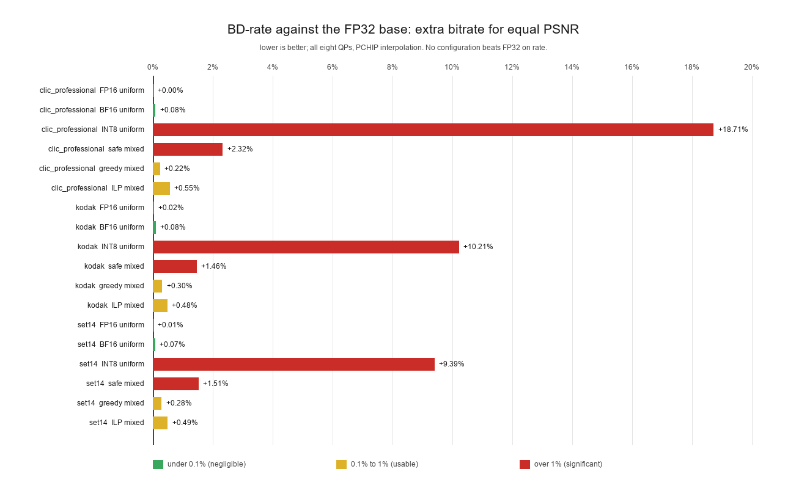
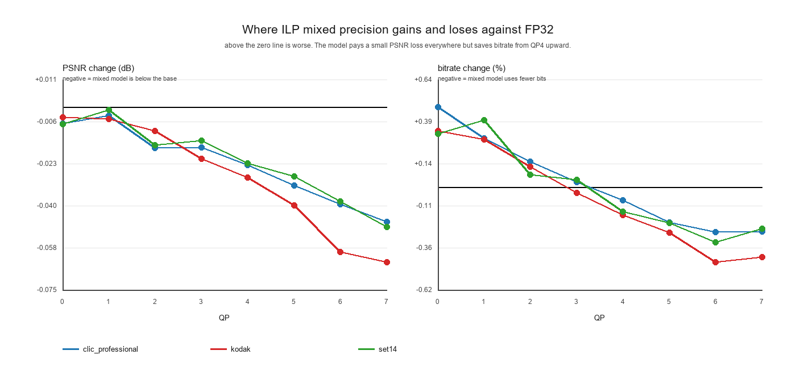

# The mixed-precision model against the FP32 base model

Every number here is measured through the real encode/decode path at all 8 QPs on three
independent image sets. Nothing is extrapolated from single-component experiments, and the FP32
gate confirms the harness reproduces the frozen reference bit-exactly (`gate_*.json`).

Configurations compared:

| Name | What it is |
|---|---|
| FP32 base | unmodified `pulse-mse`, the reference |
| FP16 / BF16 uniform | every one of the 19 components cast, the naive baselines |
| INT8 uniform | every component per-output-channel INT8, the naive aggressive baseline |
| safe mixed | each component pushed to its own 1% limit, 17.904 MB |
| greedy mixed | greedy selection, 24.565 MB |
| **ILP mixed** | **MILP optimum at a 1% worst-QP budget, 21.677 MB** |

## 1. Model size: the headline gain

| Model | Weights | Saving |
|---|---:|---:|
| FP32 base | 54.688 MB | — |
| FP16 / BF16 uniform | 27.416 MB | 49.9% |
| greedy mixed | 24.565 MB | 55.1% |
| **ILP mixed** | **21.677 MB** | **60.4%** |
| safe mixed | 17.904 MB | 67.3% |
| INT8 uniform | 13.904 MB | 74.6% (but see BD-rate) |

Where the 21.677 MB actually sits, in the ILP model:

| Part | Weight | Share |
|---|---:|---:|
| E1 + E4 at FP16 | 11.60 MB | 53.5% |
| E2 + E3 at INT8 | 5.86 MB | 27.0% |
| the other 15 components | 4.22 MB | 19.5% |

Two blocks carry over half the remaining cost because they are the only large components still at
16-bit. That is the single biggest lever left, and it is what QAT would attack.

## 2. Bitstream quality: BD-rate against FP32

Negative would mean fewer bits than FP32 at equal PSNR. No configuration achieves that.

| Config | Kodak | CLIC | Set14 | BD-PSNR (dB), Kodak / CLIC / Set14 |
|---|---:|---:|---:|---|
| FP16 uniform | +0.016% | +0.004% | +0.007% | -0.0007 / -0.0002 / -0.0003 |
| BF16 uniform | +0.084% | +0.076% | +0.071% | -0.0038 / -0.0030 / -0.0028 |
| INT8 uniform | +10.205% | +18.707% | +9.389% | -0.4426 / -0.6826 / -0.3577 |
| safe mixed | +1.457% | +2.318% | +1.511% | -0.0651 / -0.0886 / -0.0591 |
| greedy mixed | +0.299% | +0.225% | +0.278% | -0.0134 / -0.0087 / -0.0109 |
| **ILP mixed** | **+0.477%** | **+0.552%** | **+0.486%** | **-0.0214 / -0.0213 / -0.0191** |

Uniform INT8 is 20-40x worse than the mixed assignments. FP16 is effectively free.

## 3. Where the ILP model is better

**Weight footprint.** -60.4% with no retraining, versus -49.9% for uniform FP16. At equal size the
choice is stark: 21.677 MB at +0.48% BD-rate beats 27.416 MB at +0.02%, or you can read it the
other way and say FP16 buys the first half of the compression for almost nothing.

**Bitrate at high QP.** This is the non-obvious win. At QP4-QP7 the quantized encoder produces
*fewer* bits than FP32:

| QP | Kodak d_bpp | CLIC d_bpp | Set14 d_bpp |
|---:|---:|---:|---:|
| 0 | +0.335% | +0.478% | +0.319% |
| 3 | -0.036% | +0.028% | +0.044% |
| 4 | -0.167% | -0.081% | -0.146% |
| 5 | -0.274% | -0.211% | -0.215% |
| 7 | -0.419% | -0.268% | -0.250% |

Perturbing the encoder marginally changes the latents in a way that makes them slightly cheaper to
code. So at the quality settings that matter in practice, the model is simultaneously 60% smaller
and produces a smaller file.

**Transfer.** The assignment was fitted on Kodak and CLIC only, yet Set14 lands within 0.05% of the
other two on BD-rate. The result is not overfitted to the fitting sets.

## 4. Where it is worse

**PSNR, everywhere, and worsening with QP.** The loss grows monotonically from -0.004 dB at QP0 to
-0.063 dB at QP7 on Kodak. Peak measured loss across all three sets is **-0.0634 dB**.

**ILP is not the best BD-rate.** Greedy has a better BD-rate (+0.225 to +0.299%) than ILP
(+0.477 to +0.552%) because greedy spends 2.9 MB more on weights. This is a genuine trade-off, not
a bug:

| If you care about | Pick | Why |
|---|---|---|
| Weight footprint, memory budget | ILP, 21.677 MB | smallest model inside 1% |
| Bitstream efficiency | greedy, 24.565 MB | about half the BD-rate penalty |

Both are inside the 1% penalty budget on every dataset. The earlier claim that ILP is simply "the
recommended operating point" needs that qualifier.

**The fragile components stay expensive.** H0, H3 and D5 cannot go below FP16, so the entropy
network and renderer MLP contribute fixed cost with no compression available inside the 1% budget.

## 5. Speed: not measured, and nothing here makes it faster

I have to be blunt, because it is the one part of your question I cannot answer with evidence.

**There is no latency, throughput, energy or memory measurement for any quantized configuration in
this repository.** The mixed model and the base model run at the same speed by construction: the
quantizer writes quantized values back into FP32 tensors, so every convolution still executes in
FP32 on the same kernels. There is no faster path to measure. The repository even states this as a
rule: "fake-quant latency/energy/memory are intentionally excluded; they belong to the real-format
benchmark."

So the honest answer to "how much faster did it become" is: **the model is 60.4% smaller in bytes
and 0% faster in wall-clock time as built.** Any speed claim at this point would be invented.

What it would take to produce a real speed number:

| Path | Status | Expected |
|---|---|---|
| FP16/BF16 modules actually run in half precision | not done; FP16/BF16 are real on `sm_86` | measurable now, the cheapest honest win |
| INT8 kernels (TensorRT or ONNX Runtime on the E2/E3 blocks) | not built; needs ONNX export | where the real gain is |
| Simulated formats (FP8, FP4, INT4) | by definition no speed claim | forbidden |

If you want a speed figure, the realistic next step is a half-precision latency benchmark, roughly
three hours: cast the FP16/BF16 components with `.half()`, time encode and decode against FP32 on
the same images, and report J/image and ms only for formats that genuinely execute differently.

## 6. Summary

| Dimension | Verdict |
|---|---|
| Model size | **60.4% smaller**, 54.688 to 21.677 MB |
| Bitstream at equal PSNR | **+0.48% worse** (Kodak), +0.55% (CLIC), +0.49% (Set14) |
| Bitrate at QP4-QP7 | **0.08% to 0.42% smaller files** |
| PSNR | -0.004 to -0.063 dB, worst at QP7 |
| Robustness across datasets | stable within 1.4x, vs 2.9x for uniform INT8 |
| Speed | **unchanged and unmeasured**; no fast path exists yet |
| Retraining required | none |

## Files

- `bd_rate.csv`, `comparison_ilp_vs_fp32.csv`: the numbers above
- `comparison_rd_curves.png`, `comparison_bd_rate.png`, `comparison_ilp_dpsnr.png`: three figures
- `sweep_<dataset>.csv`: raw per-image, per-QP rows behind all of it
